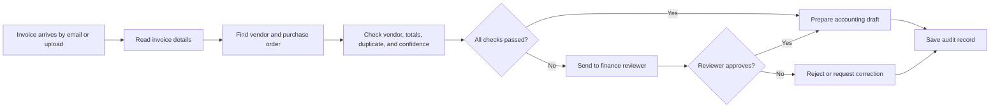
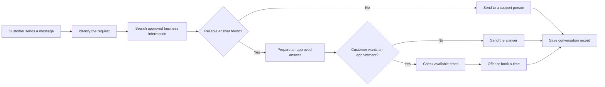
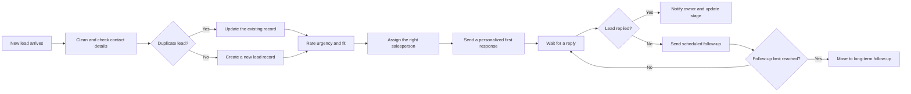
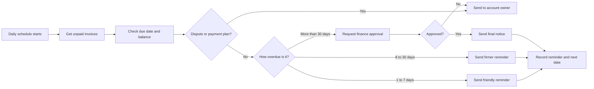
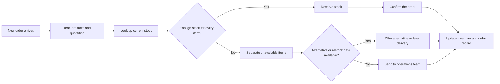
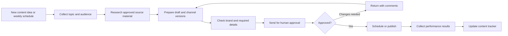
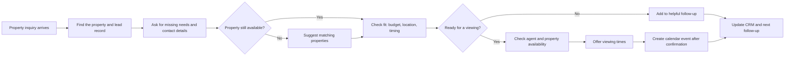

# Project Portfolio — Workflow Build Plan

This document is the blueprint for the n8n portfolio workflows. Each project is designed to be understandable by a business owner: the canvas should show where work begins, what the automation checks, when a person must approve something, and what result is produced.

## Portfolio build order

| Order | Project | Business area | Main result |
|---:|---|---|---|
| 1 | Automated Invoice Processing | Finance | Clean invoices are prepared; exceptions go to a person |
| 2 | AI Customer Support and Appointment Booking | Customer service | Customers receive approved answers and can book a meeting |
| 3 | Automatic Lead Assignment and Follow-Up | Sales | Every new lead receives a quick response and has a clear owner |
| 4 | Automated Customer Payment Follow-Up | Finance | Overdue customers receive polite, scheduled reminders |
| 5 | Automatic Order and Inventory Checking | Operations | Orders are checked against available stock before confirmation |
| 6 | Content Planning and Publishing Automation | Marketing | Content moves from idea to approval, publishing, and reporting |
| 7 | Real Estate Lead Follow-Up and Viewing Booking | Real estate | Property inquiries are qualified and moved toward a viewing |

## Rules for every workflow

- Prefer visible n8n nodes such as Trigger, Edit Fields, IF, Switch, Merge, Wait, Gmail, Google Sheets, Calendar, Slack, and database nodes.
- Use a Code node only when a task cannot be expressed clearly with standard nodes.
- Every workflow must include sample data, a happy path, an exception path, and a human handoff.
- Portfolio versions must not send real messages, create real bills, or modify live records.
- Live actions remain disabled until credentials, test accounts, and approval rules are confirmed.
- Node names must describe business actions, not technical actions.
- Each workflow ends with a simple record showing what happened, when it happened, and what happens next.

---

## 1. Automated Invoice Processing

### Purpose

Reduce manual invoice checking while preventing incorrect or suspicious invoices from reaching the accounting system.

### Process map

### Recommended n8n nodes

1. Email Trigger, Google Drive Trigger, or Form Trigger
2. Extract From File
3. Information Extractor or AI node for reading the invoice
4. Google Sheets, Airtable, or accounting lookup for vendor and purchase-order records
5. Edit Fields for totals and standardized values
6. IF nodes for approved vendor, duplicate invoice, amount difference, and reading confidence
7. Form, Slack, or email approval step
8. QuickBooks or Xero node to create a **draft**, never a final payment
9. Data Table or Google Sheets audit record

### Human approval

A finance reviewer is required when the vendor is unknown, the invoice may be a duplicate, totals do not match, the purchase-order difference exceeds the limit, or the invoice cannot be read confidently.

### Portfolio test cases

- Clean invoice that matches an approved purchase order
- New vendor that requires review
- Duplicate invoice number
- Incorrect total or large purchase-order difference
- Poor-quality document that cannot be read confidently

### Success measures

- Percentage of invoices processed without manual data entry
- Average time from receipt to accounting draft
- Number of exceptions caught before posting
- Duplicate invoices prevented

---

## 2. AI Customer Support and Appointment Booking

### Purpose

Answer common customer questions using approved business information, book appointments, and safely hand uncertain questions to a person.

### Process map

### How RAG fits in

RAG means the assistant searches the company's approved information before answering. The portfolio demo should use a small approved knowledge source. The production version can search Google Drive, Notion, website pages, or a vector database. The assistant must not invent an answer when the source does not contain one.

### Recommended n8n nodes

1. Chat Trigger, Webhook, Gmail Trigger, or Facebook Lead/Webhook
2. Text Classifier for FAQ, appointment, complaint, sales, or human-help request
3. Google Drive, Notion, Supabase Vector Store, Pinecone, or another approved knowledge source
4. Question and Answer Chain or AI Agent with tightly limited tools
5. IF node for answer confidence and risky topics
6. Google Calendar availability and event nodes
7. Gmail, WhatsApp, or chat response node
8. CRM or Data Table conversation record

### Human approval

Send the conversation to a person when no reliable source is found, the customer complains, money or legal promises are requested, the customer asks for a person, or the proposed answer is below the agreed confidence level.

### Portfolio test cases

- Common service question answered from approved information
- Appointment request with an available time
- Appointment request when no suitable time is available
- Question that is missing from the knowledge source
- Risky request such as a guaranteed financial or legal outcome

### Success measures

- Percentage of common questions answered automatically
- Appointments booked without staff involvement
- Average first-response time
- Questions correctly handed to a person

---

## 3. Automatic Lead Assignment and Follow-Up

### Purpose

Respond quickly to every new lead, assign the right salesperson, and prevent promising opportunities from being forgotten.

### Process map

### Recommended n8n nodes

1. Form Trigger, Webhook, Gmail Trigger, or lead-ad trigger
2. Edit Fields for standardized names, email, phone, and source
3. CRM search node plus IF for duplicate checking
4. Switch for location, service, budget, or urgency
5. CRM create/update and owner assignment
6. Gmail or messaging node
7. Wait node for follow-up timing
8. IF node for reply detection and follow-up limits
9. Slack or email notification to the assigned salesperson

### Human approval

Require review for missing contact details, conflicting territory rules, very high-value leads, opt-out requests, or messages that may be complaints rather than sales inquiries.

### Portfolio test cases

- New high-priority lead
- Normal lead assigned by location
- Duplicate lead
- Lead replies after the first message
- Lead does not reply after the allowed follow-ups

### Success measures

- Time to first response
- Percentage of leads assigned correctly
- Leads receiving every planned follow-up
- Meetings or sales opportunities created

---

## 4. Automated Customer Payment Follow-Up

### Purpose

Help finance teams follow up overdue invoices consistently without sending inappropriate reminders to customers with disputes or payment arrangements.

### Process map

### Recommended n8n nodes

1. Schedule Trigger
2. QuickBooks, Xero, Airtable, or Google Sheets lookup
3. Filter for unpaid and overdue invoices
4. IF or Switch for overdue age, dispute, and payment-plan status
5. Gmail or Outlook reminder templates
6. Wait or next-follow-up date calculation
7. Slack, email, or Form approval for sensitive accounts
8. CRM/accounting note and audit record

### Human approval

Require review for disputed bills, promised payment dates, active payment plans, VIP customers, incorrect contact details, or final notices.

### Portfolio test cases

- Newly overdue invoice
- Invoice overdue by two weeks
- Invoice overdue by more than 30 days
- Customer with an active dispute
- Customer who already paid after the list was prepared

### Success measures

- Overdue balance reduced
- Average days to payment
- Staff time saved on reminder preparation
- Incorrect reminders prevented

---

## 5. Automatic Order and Inventory Checking

### Purpose

Check whether products are available before confirming an order and alert the right person when stock is low or missing.

### Process map

### Recommended n8n nodes

1. Webhook, Shopify, WooCommerce, or order-form trigger
2. Split Out for individual order lines
3. Inventory database or Google Sheets lookup
4. IF for available quantity and reorder level
5. Aggregate to rebuild the complete order result
6. Shopify/WooCommerce update or Edit Fields demo record
7. Email or Slack customer/operations notification
8. Data Table audit record

### Human approval

Require review for partial orders, substitutions, negative stock, unusually large orders, price differences, or manual stock corrections.

### Portfolio test cases

- All products available
- One product unavailable
- Product below reorder level
- Large order requiring approval
- Inventory changed while the order was being checked

### Success measures

- Overselling incidents prevented
- Order-confirmation time
- Low-stock alerts acted on
- Manual inventory checks reduced

---

## 6. Content Planning and Publishing Automation

### Purpose

Move content from idea to approved post while keeping a person in control of brand quality and publishing.

### Process map

### Recommended n8n nodes

1. Schedule Trigger, Form Trigger, Notion, Airtable, or Google Sheets
2. Google Drive or approved source lookup
3. AI node for draft preparation, repurposing, or summaries
4. Edit Fields for channel, audience, links, and publishing date
5. IF for missing sources, required disclaimer, and approval status
6. Form, Slack, email, or task-management approval
7. LinkedIn, WordPress, Buffer, or other publishing node where available
8. Wait until publishing time
9. Analytics lookup and content tracker update

### Human approval

No public content is published until a person approves the final wording, factual claims, image rights, links, and scheduled date.

### Portfolio test cases

- Approved post published on schedule
- Draft returned for changes
- Missing source or required link
- Time-sensitive post held for manual review
- Published post added to the reporting tracker

### Success measures

- Time from idea to approved draft
- Hours saved on repurposing
- Percentage published on schedule
- Engagement or leads by content type

---

## 7. Real Estate Lead Follow-Up and Viewing Booking

### Purpose

Respond quickly to property inquiries, understand what the buyer or renter needs, and help qualified leads book a viewing.

### Process map

### Recommended n8n nodes

1. Webhook, Facebook lead form, property portal email, or website form
2. CRM search and duplicate check
3. Property database, Airtable, or Google Sheets lookup
4. IF for availability and complete contact details
5. Switch for buying/renting, area, budget, property type, and urgency
6. Gmail, WhatsApp, or SMS conversation step
7. Google Calendar availability and event nodes
8. Wait and follow-up sequence
9. CRM update and agent notification

### Human approval

Send to an agent for unusual pricing questions, negotiation, unavailable properties with no suitable alternative, incomplete identity/contact information, complaints, or viewing changes that affect another party.

### Portfolio test cases

- Available property and qualified lead
- Unavailable property with alternatives
- Missing budget or contact details
- Viewing booked successfully
- Lead does not confirm the proposed time

### Success measures

- Inquiry response time
- Percentage of qualified leads booking viewings
- Follow-ups completed on time
- Agent time saved on early-stage questions

---

## Build phases for each project

### Phase 1 — Safe portfolio demo

- Manual Trigger or test form
- Clearly labeled sample data
- Native decision, routing, merge, and record-keeping nodes
- No real messages or changes to live systems
- At least three test cases with visible results

### Phase 2 — Connected test version

- Test inbox, form, spreadsheet, CRM, calendar, or accounting sandbox
- Credentials stored in n8n Credentials, never inside nodes
- Real error handling and retry paths
- Approval step before any sensitive action

### Phase 3 — Production-ready version

- Live trigger and live business systems
- Access limited to what the workflow needs
- Duplicate protection and safe reruns
- Error notifications, audit history, and recovery instructions
- Agreed success measures reviewed after launch

## Definition of done

A portfolio workflow is complete only when:

- A non-technical viewer can understand the canvas from left to right.
- Standard n8n nodes show the important business logic.
- The workflow has a happy path, exception path, and human handoff.
- Sample runs prove every important path.
- Sticky notes explain the problem, value, safety checks, and next integration phase.
- Screenshots and a short case-study summary are ready for the website.
- The workflow is inactive until the connected test version has been approved.
